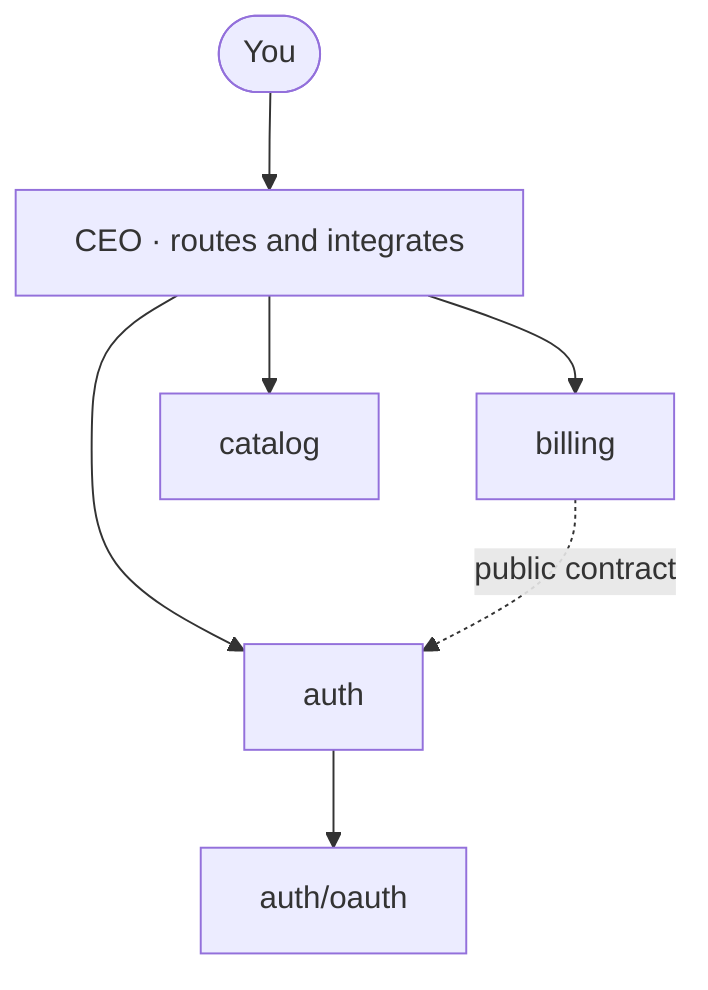

<p align="center">
  
</p>

<h1 align="center">CodeCEO</h1>

<p align="center">
  <b>Run your codebase like a company.</b><br>
  One agent per module. Each one remembers its zone. Nobody has to read the whole repo.
</p>

<p align="center">
  <a href="LICENSE"></a>
  
  
  <a href="https://github.com/sauvageduck24/CodeCEO/actions/workflows/test.yml"></a>
</p>

---

A single coding agent that has to understand your whole repository wastes context, forgets things between
chats, and edits code it should not touch. **CodeCEO** gives every module of your project its own agent,
with its own persistent memory, and puts a CEO on top that routes each request to the people who own it.

- **Easy things stay easy.** A question about billing is answered by the *billing* agent, from billing's own
  context. It never loads auth, the UI or the build system.
- **Hard things become possible.** A change that crosses modules is split into waves, coordinated through
  contracts, reviewed and integrated, with every decision traced.
- **Nothing gets lost.** Each zone's knowledge lives in `.codeceo/contexts/*.md`. Close the chat, open
  another one tomorrow, and the same organisation is back.

## How it works



1. **Scan.** CodeCEO reads your repo, builds the dependency graph, and derives one agent per module.
   A small project is a single agent; zones only split when the code is too big for one head.
2. **Remember.** Every agent writes down what its zone is for, why it is built that way, and what breaks
   it. Facts (public API, dependencies, health) are regenerated automatically; notes are flagged stale when the
   code underneath them changes.
3. **Route.** Your request is matched to the zones that own the code. Those agents get a small brief
   (their notes, their neighbours' contracts, the relevant snippets) and work in parallel.
4. **Protect.** An agent can only edit files it owns. For anything else it sends a message to the owner.
   Contract changes are diffed, dependents are notified, and the integration is checked before it is accepted.

## Install

```text
/plugin marketplace add sauvageduck24/CodeCEO
/plugin install codeceo@codeceo
```

Requires Node.js 18+ (no `npm install`, no dependencies).

### Update

```bash
claude plugin marketplace update codeceo
claude plugin update codeceo@codeceo
```

Then restart Claude Code. Your `.codeceo/` folder is never touched by an update, so every zone context
and org decision carries over. Check the installed version with `claude plugin list`.

### Uninstall

```bash
claude plugin uninstall codeceo@codeceo
```

This removes the plugin only; delete `.codeceo/` too if you want the project back to how it was.

## Use

```text
/codeceo:start
```

That is the only command you need. It adopts the project (one context file per zone) and turns
**CodeCEO mode** on. From then on you just talk, exactly as with plain Claude Code:

> *how does checkout apply discounts?*
> *make invoices round half-up*
> *fix the login bug where expired tokens are accepted*

Questions and code changes both work. Each message is routed to the zones that own the code, they do
the work in parallel, and cross-module changes are checked before they are accepted. Close the chat, open
a new one: the mode and the organisation are still there.

| Optional | |
|---|---|
| `/codeceo:stop` | pause the mode; Claude works normally (nothing is deleted) |
| `/codeceo:status` | org chart, stale zones, open messages |
| `/codeceo:org` | reshape the organisation in plain language |
| `/codeceo:ask` · `/codeceo:change` | force read-only or edit mode for one request |

## You are the CEO

The organisation follows your code, but your decisions override it. Use `/codeceo:org` to say in plain
language who is responsible for what, who reports to whom, who may talk to whom, which zone to freeze,
and which files belong elsewhere. It is all stored in `.codeceo/charter.json`.

> More levels are not better. Every level is another handoff where information gets lost. CodeCEO adds
> depth only where a zone is genuinely too large, and `/codeceo:org` will tell you when you ask for more
> hierarchy than the code needs.

## What lives in your repo

```text
.codeceo/
├─ contexts/<zone>.md    what each agent knows: purpose, decisions, gotchas  (commit)
├─ charter.json          your org decisions and who may talk to whom         (commit)
├─ contracts.json        accepted public API of each zone                    (commit)
├─ ledger.jsonl          decision and change trace                           (commit)
├─ org.json  state.json  config.json  inbox/                                 (commit)
└─ index/ routes.json …  derived data, rebuilt automatically                 (git-ignored)
```

Commit it and every teammate and every future chat starts from the same shared understanding.

## Beyond Claude Code

The core (`core/`) is plain Node with no model and no harness inside it. Claude Code is one thin adapter
(`adapters/claude-code/`). Everything is also available as a CLI (`codeceo help`) and a JSON permission
check (`codeceo guard`), so Codex, Pi or any other agent harness can plug in. See
[docs/PORTING.md](docs/PORTING.md).

## Honest status

CodeCEO is young (v0.1). Import and API extraction is regex-based (JS/TS, Python, Go, Rust, Java, Kotlin,
C/C++, Ruby, PHP), retrieval is lexical with an optional embeddings provider, and write scopes are enforced
on the edit tools; shell commands are only caught afterwards by `integrate`. The token and quality gains are
the hypothesis, not a result yet: [docs/EVALUATION.md](docs/EVALUATION.md) describes how to measure them
against a conventional single-agent setup, and `codeceo bench` gives an offline estimate on your own repo.

## Docs

[Architecture](docs/ARCHITECTURE.md) · [Porting to other harnesses](docs/PORTING.md) · [Evaluation](docs/EVALUATION.md)

## Star history

<a href="https://star-history.com/#sauvageduck24/CodeCEO&Date">
  <picture>
    <source media="(prefers-color-scheme: dark)" srcset="https://api.star-history.com/svg?repos=sauvageduck24/CodeCEO&type=Date&theme=dark">
    
  </picture>
</a>

## License

[MIT](LICENSE)
